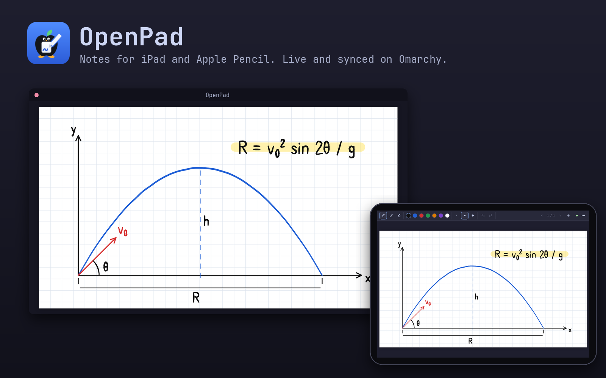

# OpenPad


Open-source notes for iPad and Apple Pencil, with your computer as the hub.

- **Notebooks** have sections, and sections have pages: lined, grid, dot,
  engineering or blank paper, or the pages of a PDF.
- **Tools for math and physics notes:** pressure pen with adjustable
  sensitivity, highlighter, eraser, lasso to move or recolor, and shapes
  (line, arrow, box, ellipse, axes). Hold the pen still at the end of a stroke
  to straighten it.
- **Live on your computer:** the notebook you have open shows in a clean
  window you can share in Zoom, Teams or Meet.
- **Guests:** send a link, and people can watch live, write with you (if you
  allow it) and save any page as a PDF.
- **Synced:** every notebook is copied to your computer's disk, with readable
  PDFs in `Documents/OpenPad`.
- **Desktop annotation:** draw over a live view of any window on your computer.

It runs on Omarchy (as a bar plugin), other Linux distributions, macOS and
Windows 11. The iPad uses Safari, or an optional home-screen app that works
offline. There are no accounts and no cloud: everything stays on your network,
unless you switch on an internet link for guests.

OpenPad was called Inkcast until version 0.5. Upgrading moves your board,
pairing key and settings over.



## What works where

| | Omarchy | Other Linux | macOS | Windows 11 |
| --- | --- | --- | --- | --- |
| Notes app, sync, share window, guests | yes | yes | yes | yes |
| Internet links for guests | cloudflared | cloudflared | cloudflared | cloudflared |
| Annotate a desktop window | system picker | system picker, or Chrome/Edge | Chrome/Edge | Edge/Chrome |
| Mirror the iPad (AirPlay) | UxPlay | UxPlay | built into macOS | no |
| Bar widget, theme matching | yes | no | no | no |

You need an iPad with Safari, and Python 3.9 or newer on the computer. There
are no pip packages. PDFs are drawn by the bundled pdf.js, so nothing else is
needed for them.

## Install

### Omarchy

```bash
omarchy plugin add https://github.com/0w3n-N/openpad.git --enable
```

Click the OpenPad icon in the bar and choose **Setup**. It runs `scripts/setup`
in a terminal, and every step asks first:

1. Install the window-capture packages, if they're missing.
2. Optional: install cloudflared for internet guest links.
3. Optional: install UxPlay (AUR) and enable avahi-daemon for AirPlay.
4. Open ufw for TCP 8770 (plus AirPlay ports if UxPlay is installed), only
   from private network ranges.
5. Optional: add an `openpad` command and launcher entries.

Update with `omarchy plugin update io.github.0w3n-n.openpad`. To remove:

```bash
~/.config/omarchy/plugins/io.github.0w3n-n.openpad/scripts/uninstall
omarchy plugin remove io.github.0w3n-n.openpad
```

Coming from Inkcast? Install OpenPad as above, run Setup once (it offers to
remove Inkcast's command, launcher entries and firewall rules), then
`omarchy plugin remove io.github.0w3n-n.inkcast`.

### Other Linux

Only Python is required. The other packages enable window annotation, internet
links and AirPlay.

```bash
# Arch
sudo pacman -S python python-gobject gst-plugin-pipewire gst-plugins-good cloudflared
# Debian, Ubuntu (cloudflared: see pkg.cloudflare.com)
sudo apt install python3 python3-gi gir1.2-gstreamer-1.0 gstreamer1.0-pipewire gstreamer1.0-plugins-good uxplay
# Fedora (cloudflared: see pkg.cloudflare.com)
sudo dnf install python3 python3-gobject gstreamer1-plugins-good pipewire-gstreamer uxplay
```

Then get OpenPad and run its setup (firewall, `openpad` command, launcher entry):

```bash
git clone https://github.com/0w3n-N/openpad.git ~/openpad
~/openpad/scripts/setup
~/openpad/bin/openpad
```

Setup handles ufw. With firewalld, open the port yourself:
`sudo firewall-cmd --permanent --zone=home --add-port=8770/tcp && sudo firewall-cmd --reload`,
and make sure your Wi-Fi connection is in the `home` zone.

Update with `git -C ~/openpad pull`. Remove with `~/openpad/scripts/uninstall`,
then delete the folder.

### macOS

```bash
git clone https://github.com/0w3n-N/openpad.git ~/openpad
~/openpad/scripts/setup         # offers to add an `openpad` command
~/openpad/bin/openpad
brew install cloudflared        # optional, for internet guest links
```

The `python3` that comes with macOS (Xcode Command Line Tools) is new enough.
macOS installs it the first time you run `git` or `python3`.

- If the macOS firewall is on, allow incoming connections for Python when asked.
- To annotate windows, install Chrome or Edge. The first time, macOS asks you to
  allow screen recording for the browser (System Settings › Privacy & Security ›
  Screen & System Audio Recording).
- For mirroring, use the built-in AirPlay Receiver (System Settings › General ›
  AirDrop & Handoff).

Update with `git -C ~/openpad pull`. To remove, delete the folder and
`~/Library/Application Support/openpad`.

### Windows 11

1. Get the code. Either install Git (`winget install -e --id Git.Git`) and run
   `git clone https://github.com/0w3n-N/openpad.git`, or use **Code ›
   Download ZIP** on GitHub and extract it, e.g. to `Documents\openpad`.
2. Open the folder, right-click inside it, choose **Open in Terminal**, and run:

   ```powershell
   powershell -ExecutionPolicy Bypass -File scripts\setup.ps1
   ```

   It asks before each step:
   - Install Python 3.12 with winget, if it's missing.
   - Optional: install cloudflared for internet guest links.
   - Add a firewall rule for TCP 8770 on private networks. Windows shows an
     admin prompt.
   - If your Wi-Fi is marked Public, offer to mark it Private. Do this only on
     your own network.
   - Add a Start menu shortcut and an optional `openpad` command.
3. Start **OpenPad** from the Start menu. If Windows Defender Firewall asks
   about Python, allow **Private networks**.

Window annotation uses Edge, which comes with Windows: click **Window** in the
OpenPad window and pick the window. AirPlay mirroring isn't available on
Windows.

Update with `git pull`, or download the ZIP again. To remove, run
`powershell -ExecutionPolicy Bypass -File scripts\uninstall.ps1`, then delete
the folder.

## Use

### The native iPad app (preview)

A native app (SwiftUI and PencilKit) is in [ios/](ios/README.md). It has
Apple's own ink and tool palette, and the Pencil's double-tap and squeeze. It
connects without the certificate step, and works with the same computer side.
It installs through TestFlight (needs an Apple Developer account), from Xcode
on a Mac, or by sideloading the unsigned build each CI run produces. The
instructions below are for the web app, which needs no install.

### Start it and connect the iPad

Switch OpenPad on from the bar icon (Omarchy), the Start menu (Windows), or
run `openpad`. The bar popup and the share window's **Pair** card show one QR
code. It works two ways:

- **In the OpenPad app:** tap **Connect to computer** and scan the code. The
  app then syncs and shows your open notebook on the computer.
- **With the iPad Camera app:** OpenPad opens in Safari right away, with
  nothing to install. That copy needs the computer to be on, and it offers to
  install the app.

**Installing the app** (about a minute, once). The Safari copy's **Set up**
banner, or Settings › Connect in the app, links to these steps:

1. Download OpenPad's certificate and turn it on in Settings › General ›
   About › Certificate Trust Settings. The app talks to your computer over
   HTTPS, which needs this certificate. Your computer made the certificate
   itself, and it only works for private network addresses, so it can't be
   used to impersonate websites.
2. Open https://0w3n-n.github.io/openpad/ and use Share › **Add to Home
   Screen**.
3. Open OpenPad from the Home Screen › **Connect to computer** › scan the QR
   code. No camera? Enter the address and 6-digit PIN shown under the code.

After that the app opens with no Wi-Fi at all, and syncs whenever the iPad and
computer are on the same network. If the computer's address changes, the app
tries its `.local` name, so you rarely need to connect again.

### Notebooks, sections and pages

- **New notebook** asks for a name and page size: Letter, A4, or Widescreen
  (fits a call best).
- The sidebar (☰) lists sections and page thumbnails. **+ Section** adds a
  section; tap a section's name to rename, reorder, export or delete it.
- **+** in the toolbar adds a page after the current one, at any time,
  including during a live session. Use ⋯ › **Move this page** to move it to
  another section.
- ⋯ › **Paper** sets the current page's paper: blank, lines, grid, dots or
  engineering.

### Write on a PDF

**Import PDF** in the library makes a new notebook from a PDF. ⋯ › **Import
PDF as a new section** adds one to the open notebook, and you can also drop a
PDF on the share window. Each PDF page becomes a page you can write on. PDFs
are read on the device with pdf.js, so this works offline in the installed
app.

### Show it on a call

The notebook you have open on the iPad appears in the share window. In Zoom,
Teams or Meet, share the window titled **OpenPad**. Its controls hide when the
mouse is still. Page changes on either side follow each other. To keep a
notebook private, turn off ⋯ › **Show on the computer**.

### Invite people

Open **Invite** in the share window, ⋯ › **Invite people…** on the iPad, the
bar popup, or run `openpad invite`. There are two links:

- **Can draw:** guests write along with you. They can erase their own ink, not
  yours. ⋯ › **Remove guests' ink on this page** clears theirs.
- **View only:** guests watch.

Guests open the link in any browser (laptop, phone or tablet). They see the
notebook you're showing, follow your page (or browse on their own), and can
**Save PDF** of the page, the section or the whole notebook, choosing where it
goes. They can't open your other notebooks or control the computer.

By default the links only work on your Wi-Fi. For people elsewhere, switch on
**Internet link** (needs cloudflared). OpenPad then opens a free Cloudflare
quick tunnel for as long as it's on, and gives you a `trycloudflare.com` link.
That traffic is encrypted, but it passes through Cloudflare. Only guest pages
are reachable through it. Links last until OpenPad stops; **New links**
disconnects everyone sooner. When nothing is open on the iPad, guests see a
waiting screen, never one of your other notebooks.

### Sync to the computer

Notebooks sync automatically whenever the iPad and computer can reach each
other: on start, every 20 seconds while something changed, and when you leave
the app. Both sides merge, so nothing written on either side is lost, and
deletions carry over. On the computer:

- `Documents/OpenPad/<Notebook>/<Section>.pdf`: readable copies, rebuilt a
  minute or so after changes. Set `OPENPAD_NOTES` to use another folder.
- The notebooks themselves, in OpenPad's data folder (see Troubleshooting).
  Deleted notebooks are kept in its `trash` folder for a while.

A second iPad paired with the same computer gets the same notebooks.

### Annotate a desktop window

Show one desktop window (slides, code, a simulation) on the iPad and draw over
it:

1. Start it with **Annotate a window** (bar popup), **Window** in the share
   window, ⋯ on the iPad, or `openpad annotate`.
2. Pick the window on the computer. Linux uses the system share picker. On
   macOS and Windows, click **Choose a window** in the share window. Someone
   at the iPad can't skip this step.
3. The window appears as a new page, live at up to 15 frames per second.
   Pinch-zoom on the iPad to look closer; this doesn't change the window.
4. Stop it from the same places. The last frame stays on the page.

The ink is placed on the page, not tied to the window's content, so it doesn't
follow when the window scrolls.

### Mirror the iPad (AirPlay, Linux)

Toggle **AirPlay receiver** in the bar popup, or run `openpad mirror`. On the
iPad: Control Center › Screen Mirroring › **Omarchy**, then enter the 4-digit
PIN shown in the popup or terminal.

## Controls

**iPad**

| Input | Action |
| --- | --- |
| Pencil | draw with the current tool, with pressure |
| Pencil tip double-tap on one spot | switch pen ↔ eraser (turn off in Settings) |
| Hold the Pencil still at the end of a stroke | straighten it into a line |
| One finger | pan |
| Two fingers | zoom |
| ⚙ / ⋯ › Settings | pressure sensitivity (with a preview), double-tap, finger drawing, pairing |

The Pencil's barrel double-tap only reaches native apps; Safari doesn't pass it
to web pages. Tapping the tip twice does the same job, and the two dots it
leaves are removed.

With a keyboard: `P` pen, `H` highlighter, `E` eraser, `S` select, `L` shapes,
`⌘Z` / `⇧⌘Z` undo/redo, `←` `→` pages, Delete removes a selection.

**Share window**

| Input | Action |
| --- | --- |
| Mouse wheel / pinch | zoom at the pointer |
| Drag / two-finger scroll | pan |
| Double-click, `0` | zoom 2×, back to fit |
| `L` | follow the pen while zoomed |
| `←` `→` Space | change page (the iPad follows) |
| `I` `Q` `W` | invite, pair, annotate a window |
| `O` `S` `F` | add a PDF, save as PDF, full screen |

**Guest page:** draw with the mouse, pen or finger; space + drag or the hand
tool pans; the wheel scrolls; pinch or ctrl + wheel zooms.

**Omarchy bar icon**

- **Clicks:** left-click opens the popup, right-click opens the share window,
  and middle-click toggles AirPlay.
- **Color:** dimmed when off, normal while waiting for the iPad, and the accent
  color while the iPad is connected, a window is live, or mirroring is on.
- **Keybindings:** `omarchy-shell io.github.0w3n-n.openpad <action>`, where the
  action is `board`, `invite`, `toggle`, `annotate`, `mirror`, `start` or
  `stop`.
- **Settings:** `port`, `airplayName` and `airplayAudio`, on the widget's entry
  in `~/.config/omarchy/shell.json`.

## Command line

On Linux and macOS, run `openpad` if setup added it, otherwise `bin/openpad`.
On Windows, run `openpad` if setup added it to PATH, otherwise `bin\openpad.cmd`.

```
openpad              start if needed and open the share window
openpad invite       guest links (--internet for a link that works anywhere, --off to stop it)
openpad annotate     annotate a desktop window (--stop to end it)
openpad url          print the iPad link and QR code
openpad status       running, connected devices and guests (--json)
openpad doctor       check packages, firewall, network and the notes folder
openpad start|stop   start or stop the server
openpad mirror       AirPlay receiver on Linux (--pin, --no-pin, --no-audio, --name)
```

`--port` sets the port. `--host` sets the address shown to the iPad if the
wrong one is picked; VPN and virtual adapters are skipped automatically.

## Troubleshooting

Run `openpad doctor` first.

- **The iPad can't open the page.** Common causes:
  - The firewall blocks the port: run setup.
  - The iPad is on a different network. Guest Wi-Fi often isolates devices.
  - Windows has your Wi-Fi marked Public: setup can change it.
  - A VPN on the computer blocks LAN traffic. With ProtonVPN, allow LAN
    connections in its settings.
- **The installed app can't pair or sync.** Check that the certificate is
  turned on under Certificate Trust Settings, and that the address matches the
  one on the Pair card. If the computer's address changed, pair again; your
  notebooks stay.
- **"This link is missing its key".** The key changed. Scan the QR code again.
- **The internet link doesn't start.** Install cloudflared (setup offers it).
  Some networks block Cloudflare tunnels.
- **The window picker doesn't appear (Linux).** Check that your desktop's
  portal is running, e.g. `systemctl --user status xdg-desktop-portal-hyprland`.
- **Can't capture a window (macOS).** Allow screen recording for the browser,
  then restart the browser.

| | Data (notebooks, key, certificate) | Readable PDFs | Log |
| --- | --- | --- | --- |
| Linux | `~/.local/share/openpad/` | `~/Documents/OpenPad/` | `~/.local/state/openpad/server.log` |
| macOS | `~/Library/Application Support/openpad/` | `~/Documents/OpenPad/` | `~/Library/Logs/openpad/server.log` |
| Windows | `%LOCALAPPDATA%\OpenPad\` | `Documents\OpenPad\` | `%LOCALAPPDATA%\OpenPad\logs\server.log` |

## Security

Only devices you paired can open your notebooks, and guests only see the
notebook you're showing. See [SECURITY.md](SECURITY.md) for what's protected
and what isn't.

## Development

- `python3 -B tests/run.py` runs the security, sync, guest and annotation tests
  on Linux (GStreamer for annotation; Node checks that `web/model.js` and
  `openpad/notebook.py` merge identically).
- `python3 -B tests/smoke.py` runs on Linux, macOS and Windows: it starts the
  real server through the CLI, pairs, connects and stops it.
- GitHub Actions runs both, and publishes `web/` to GitHub Pages for the
  installed app (`.github/workflows/`).
- `python3 assets/build-icons.py` regenerates the icons. It needs Inkscape.
- Layout:
  - `openpad/`: server, notebook merge rules, store, TLS, tunnel, CLI, QR
    encoder, window capture, theme.
  - `web/`: the notes app, share window, guest page and setup page.
    `web/vendor/pdfjs` is Mozilla's pdf.js (Apache 2.0), unmodified.
  - `Panel.qml`, `OpenPadIcon.qml`, `Model.js`: the Omarchy bar widget.
  - `scripts/`: setup and uninstall for Linux/macOS (bash) and Windows
    (PowerShell).

See [ROADMAP.md](ROADMAP.md) for what's planned and what isn't possible yet.

## License

MIT. The icon is original artwork; the apple is a generic fruit, not Apple's
logo. pdf.js is Apache 2.0.
